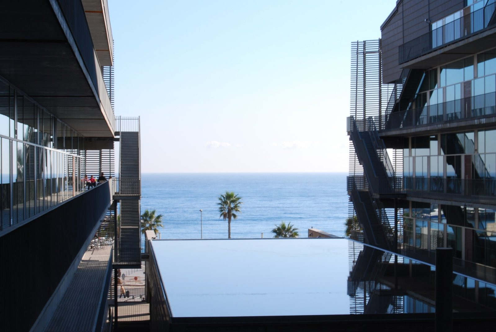

{.join-photo fig-alt="The Mediterranean seen between two wings of a glass and timber research building in Barcelona, with a reflecting pool and palm trees in front"}

## Open postdoc positions {#positions}

We have three postdoctoral positions open, one in each of our applied themes. All three involve building new generative and probabilistic models, so strong quantitative skills matter more than a background in the specific biology.

::: placeholder
For each role, add the start date, contract length, closing date and the link to the official CRG vacancy.
:::

::: {.tool}
### Virtual cell modelling
[Postdoc · Cell models for therapy]{.what}

We are developing models to enable new therapeutic strategies and cell replacement therapy.

::: {.link-row}
[Apply by email](mailto:mafalda.dias@crg.eu,jonathan.frazer@crg.eu?subject=Postdoc%20application%3A%20Virtual%20cell%20modelling){.internal}
:::
:::

::: {.tool}
### Conservation genomics and biodiversity
[Postdoc · Genetic health beyond humans]{.what}

We are developing models to monitor and manage the genetic health of endangered and domestic species.

::: {.link-row}
[Apply by email](mailto:mafalda.dias@crg.eu,jonathan.frazer@crg.eu?subject=Postdoc%20application%3A%20Conservation%20genomics%20and%20biodiversity){.internal}
:::
:::

::: {.tool}
### Rare disease diagnosis
[Postdoc · Rare and common disease]{.what}

In collaboration with Hospital Sant Joan de Déu (SJD) Barcelona, the postdoc will develop statistical models to aid the genetic diagnosis of patients with rare diseases. We are looking for someone with a strong background in statistics. [Read about this theme →](research.qmd#disease)

::: {.link-row}
[Apply by email](mailto:mafalda.dias@crg.eu,jonathan.frazer@crg.eu?subject=Postdoc%20application%3A%20Rare%20disease%20diagnosis){.internal}
:::
:::

## PhD and master's students

We are not taking new PhD or master's students at the moment. This page will be updated when that changes.

## Fellowships

We are also happy to support strong candidates applying for postdoctoral fellowships (for example Marie Skłodowska-Curie, EMBO or "la Caixa") to join the group. Get in touch well before the deadline.

::: {.callout-join}
### Get in touch

For any of the positions, email [Mafalda Dias](mailto:mafalda.dias@crg.eu) and [Jonathan Frazer](mailto:jonathan.frazer@crg.eu) with a CV and a few lines on which role interests you and why.
:::
