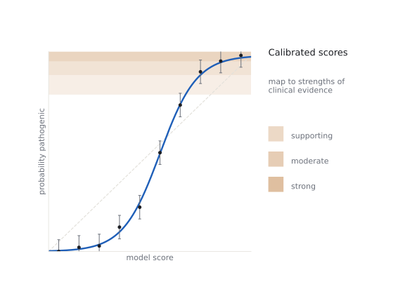



**Authors:** Mafalda Dias, Rose Orenbuch, Debora S. Marks & Jonathan Frazer

::: placeholder
No abstract was available to draft from. Add a TL;DR and a short plain-language summary.
:::

## Key figure

::: {.key-figure}

:::

## Threads & press {#threads-press}



## Cite

Dias M, Orenbuch R, Marks DS, Frazer J. Toward trustable use of machine learning models of variant effects in the clinic. *American Journal of Human Genetics* **111**, 2589–2593 (2024). [doi:10.1016/j.ajhg.2024.10.011](https://doi.org/10.1016/j.ajhg.2024.10.011)
