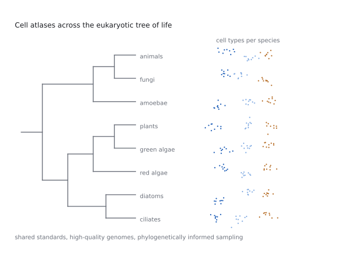

::: {.tldr}
A community plan to map cell types across the whole eukaryotic tree of life.
:::



**Authors:** Arnau Sebé-Pedrós, Amos Tanay, Mara K. N. Lawniczak, Detlev Arendt, Stein Aerts and colleagues, including Mafalda Dias and Jonathan Frazer, for the Biodiversity Cell Atlas meeting participants

## In brief

Cell types are basic functional units of life, and they can be traced across the tree of life. Single-cell technologies, together with genome sequencing of an ever wider range of species, now make it possible to characterise cells molecularly in almost any organism. Yet our picture of how cells differ across eukaryotes is still patchy, and we are far from being able to read that diversity from genome sequences.

This Perspective introduces the Biodiversity Cell Atlas, an initiative to build comprehensive single-cell atlases across the eukaryotic tree of life. It will choose species to represent the tree, rely on high-quality genomes and use shared standards so that atlases can be compared between species. The aim is to understand how cells evolve and diversify: their gene regulatory programs, how they differentiate, their molecular profiles and how organisms interact.

For our group, these atlases are the kind of data that cross-species models of cells and gene regulation will learn from.

## Key figure

::: {.key-figure}

:::

## Threads & press {#threads-press}



## Cite

Sebé-Pedrós A, Tanay A, Lawniczak MKN, et al. The Biodiversity Cell Atlas: mapping the tree of life at cellular resolution. *Nature* **645**, 877–885 (2025). [doi:10.1038/s41586-025-09312-4](https://doi.org/10.1038/s41586-025-09312-4)
