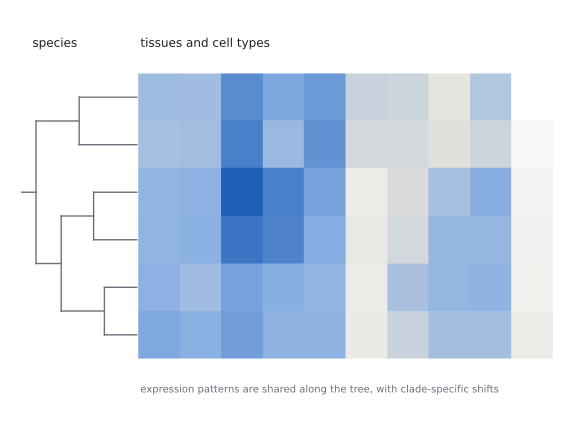



**Authors:** Matteo Zambon, Federica Mantica, Mafalda Dias, Jonathan Frazer & Manuel Irimia

::: {.tldr}
Where comparative transcriptomics is heading: cell types, the whole tree of life, and models that read expression from sequence.
:::

## In plain language

Comparing which genes are switched on, and how strongly, across species is one of the main ways to understand how molecular evolution produces differences between organisms. This review describes three directions in which the field is moving.

First, technology: bulk RNA sequencing made it possible to compare tissues and organs, and single-cell and spatial methods are now shifting the focus to cell types. Second, breadth: studies that once centred on a few model organisms and close relatives of humans now sample far more widely across the tree of life, and more deeply within groups of species. Third, modelling: growing data and machine learning are producing new frameworks, from reconstructing the evolutionary history of cell types to predicting RNA levels directly from genome sequence.

::: placeholder
Summary drafted from the abstract. The lead author should check it before launch.
:::

## Key figure

::: {.key-figure}

:::

## Threads & press {#threads-press}



## Cite

Zambon M, Mantica F, Dias M, Frazer J, Irimia M. Evolution of comparative transcriptomics: biological scales, phylogenetic spans, and modeling frameworks. *Current Opinion in Genetics & Development* **94**, 102387 (2025). [doi:10.1016/j.gde.2025.102387](https://doi.org/10.1016/j.gde.2025.102387)
