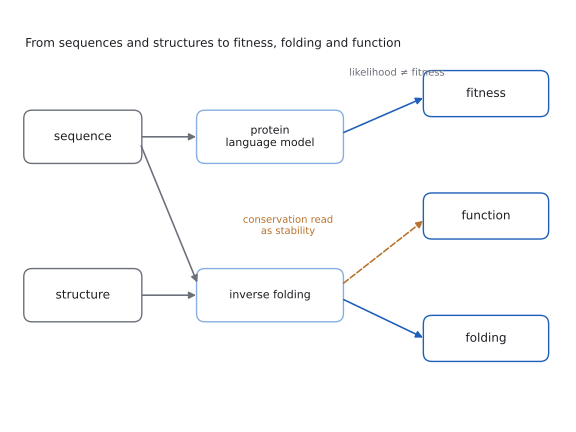

::: {.tldr}
Why bigger protein models are not always better, why structure-based models confuse function with stability, and what can be done about it.
:::



**Authors:** Ezequiel A. Galpern, Charles W. J. Pugh, Mafalda Dias & Jonathan Frazer

::: placeholder
Draft summary written from the abstract. The lead author should revise it before launch.
:::

## In brief

Deep learning has transformed how we predict the effects of mutations. Protein language models, trained on millions of natural sequences, score how evolution views any amino-acid change and have become fast, accurate predictors of fitness. Inverse-folding models add 3D structure and are used to estimate how mutations change a protein's stability.

But the scores these models output are likelihoods, not fitness or stability themselves, and the gap shows. Scaling protein language models up does not reliably make them better predictors. Inverse-folding models sometimes read evolutionary conservation as a stability constraint, which biases any attempt to separate a mutation's effect on function from its effect on folding.

This review lays out these challenges and the strategies emerging to reduce, and where possible overcome, them.

## Key figure

::: {.key-figure}

:::

## Threads & press {#threads-press}



## Cite

Galpern EA, Pugh CWJ, Dias M, Frazer J. From sequences and structures to fitness, folding and function: challenges in the age of AI. *ChemRxiv* (2026). [doi:10.26434/chemrxiv.15009409/v1](https://doi.org/10.26434/chemrxiv.15009409/v1)
