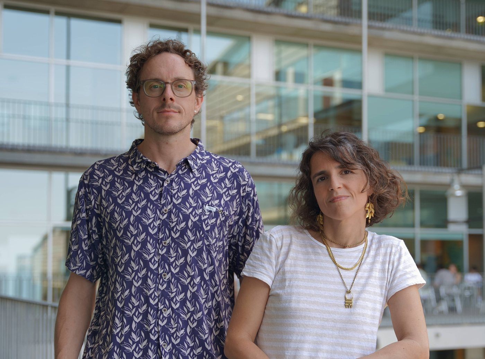

::: {.leaders}
{.duo fig-alt="Mafalda Dias and Jonathan Frazer on a balcony at the CRG building in Barcelona"}

::: {.leaders-text}
[Group leaders]{.eyebrow}

### Mafalda Dias & Jonathan Frazer

Mafalda and Jonathan lead the group together at the Centre for Genomic Regulation in Barcelona.

Mafalda is the co-chair of the [Barcelona Collaboratorium for Modelling and Predictive Biology](https://barcelonacollaboratorium.com/) and Jonathan is a senior fellow. All of the group's postdocs and PhD students are Collaboratorium fellows.

::: {.leader-links}
[Jonathan]{.who} [Bluesky](https://bsky.app/profile/jonnyfrazer.bsky.social) [X](https://x.com/Jonnygfrazer) [LinkedIn](https://www.linkedin.com/in/jonathan-frazer-6b1391236/)

[Email us both](mailto:mafalda.dias@crg.eu,jonathan.frazer@crg.eu){.internal}
:::
:::
:::

::: {#people}
:::

::: placeholder
Photos still needed for Paulina and Cristina. Bios and personal links are optional; members add their own in `data/people.yml` (see README).
:::
